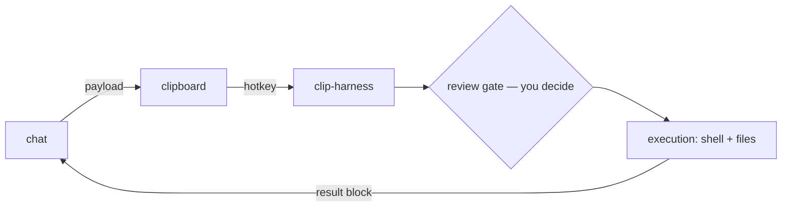

# clip-harness

A human-in-the-loop execution bridge: run AI-chat-proposed commands
from your clipboard, behind a Claude Code-style hook lifecycle with
a fail-closed review gate.



## See it work

The model emits a payload like:

````
```shell
session: auth-refactor
npm test
```
````

…and you paste back one result block — the same bytes in your
terminal and on the clipboard, ending with the goal footer that
re-anchors both of you:

````
```result
$ npm test
<output — oversized output elided to a head + tail digest; the full output stays in a file on disk>
[exit 0 · 3.2s]
files:
  ✓ src/auth.py — UPDATED
    --- a/src/auth.py
    +++ b/src/auth.py
    @@ -10,3 +10,3 @@
     unchanged context
    -old line
    +new line
[goal] Ship the auth refactor [active] (3f9a1c2e)
[open tasks] [doing] wire tokens · [open] update tests
```
````

No Mac handy? The whole lifecycle runs headlessly:
`python3 examples/sample_session/run_demo.py`.

## Install

```sh
pipx install clip-harness
clip-harness init     # default hooks + starter settings
```

Then paste [AGENTS.md](AGENTS.md) into the chat once — it teaches
the model the protocol — and wire a hotkey (or run
`clip-harness watch`) to the zero-argument trigger:
clipboard → run → result back to clipboard.

`clip` is installed as a short alias for `clip-harness`. Updates
are one explicit command — `clip-harness upgrade` —
checksum-verified, never silent. No package index where you work?
Download the wheel from
[GitHub Releases](https://github.com/millhq/clip-harness/releases),
verify it against the release's SHA256SUMS, and
`pipx install ./clip_harness-*.whl`. Details in
[Updating](docs/cli.md#updating).

## Find it fast

Full documentation: **https://millhq.github.io/clip-harness/**
(sources in [`docs/`](docs/)).

| You want | Go to |
|---|---|
| The payload protocol — fences, result block, capability manifest | [site](https://millhq.github.io/clip-harness/protocol/) · [source](docs/protocol.md) |
| Durable goals — concepts, the file store, export/import, migrations | [site](https://millhq.github.io/clip-harness/goals/) · [source](docs/goals.md) |
| Hook lifecycle, the review gate, reviewed shell commands, settings | [site](https://millhq.github.io/clip-harness/hooks/) · [source](docs/hooks.md) |
| CLI reference, updating | [site](https://millhq.github.io/clip-harness/cli/) · [source](docs/cli.md) |
| Architecture, module map, security model, platform notes | [site](https://millhq.github.io/clip-harness/architecture/) · [source](docs/architecture.md) |
| Troubleshooting | [site](https://millhq.github.io/clip-harness/troubleshooting/) · [source](docs/troubleshooting.md) |
| Development | [site](https://millhq.github.io/clip-harness/development/) · [source](docs/development.md) |

## What it is

You work somewhere the chat model you can use (e.g. M365 Copilot)
has no tools, no MCP, no shell — it can only talk, but it can
*write text*, and you can copy that text. clip-harness is the
other half of that channel: the model proposes commands and file
changes as clipboard payloads, you hit one hotkey, and the harness
executes them locally — behind a review gate you control, with a
receipt for everything, and the result copied back to the
clipboard for you to paste into the chat. Durable goals survive
the chat: lose the session, the terminal, the whole conversation,
and the work's state is still there.

Why not an API or MCP? The chat surface this was built for offers
neither — the clipboard is the one channel that exists. If your
model has real tools, you don't need this; if it can only talk,
this gives it hands, with you on the gate.

## Goal · Plan · Task

Three separate things, on purpose:

- **Goal** — the objective: a durable anchor with a stable id.
  Sessions bind to it; it outlives them.
- **Plan** — a Markdown document the model authors whole. The
  harness stores it verbatim and never parses it.
- **Task** — the only tracked execution state (`open` / `doing` /
  `done`). What is current is read off the task states; there is
  no stored "current step" that could disagree with them.

## License

MIT — see [LICENSE](LICENSE).
